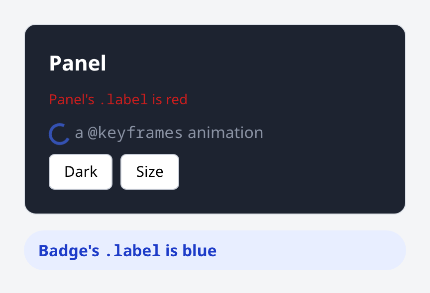

# Example: styling

Two components with their own `.css`: Panel and Badge. Both style a class
called `.label`, and neither leaks into the other. The example also shows an
`@media` query, a `@keyframes` animation, a `class:` toggle, `:class` beside a
static `class`, and an ancestor theming a descendant.



## Run it

```sh
vcsr wasm examples/styling/src
vcsr serve examples/styling/wasm     # open http://localhost:3000
```

**Dark** toggles the panel's dark theme and **Size** switches its font size.
`make screenshots` re-runs [check.mjs](check.mjs) in Chrome and refreshes the
image above. The check asserts *computed* styles, so it fails when a rule
doesn't match its markup or reaches another component.

## How scoping works

vcsr scopes styles by attribute, as Vue's `<style scoped>` does:

- Every element of a component's template carries the component's scope
  attribute, `data-s-<hash>`.
- `css.scope` adds that attribute to the **last compound** of each selector,
  before any pseudo-class: `.dark .title` becomes `.dark .title[data-s-…]`.

| In the `.css` | What vcsr does |
|---|---|
| `.label { … }` in both components | each copy matches only its own component's elements |
| `.dark .title { … }` | the ancestor part stays unscoped, so `.dark` on any ancestor themes the title |
| `@media (…) { … }`, `@supports`, `@layer`, nesting | the rules inside are scoped too |
| `@keyframes spin { … }`, `@font-face` | copied as written |
| `:root`, `html`, `body`, `:global(.x)` | left global |
| a class no element of the template uses | dropped, unless a `:class` binding can produce any class |

In the template ([src/panel.html](src/panel.html)):

| Template | What it does |
|---|---|
| `class:dark="dark"` | `dark` is on while the signal is true (`classList.toggle`) |
| `class="panel" :class="size"` | the classes `size` names are added beside `panel`, and swapped when it changes |

Each component's scoped stylesheet travels with its compiled template. The
first `view()` of a component adds it to `<head>`, once. The native mock records
it instead, readable through `runtime.styles()`. That is why
[wasm/index.html](wasm/index.html) holds only page styles.

## Files

- the triplets `panel.{v,html,css}` and `badge.{v,html,css}`
- a browser entry that mounts both views into `#app`, and a native entry
- the native test [src/styling_test.v](src/styling_test.v) (`make test`)
- the browser check [check.mjs](check.mjs) (`make examples`)
